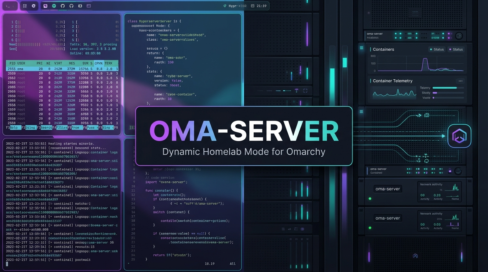
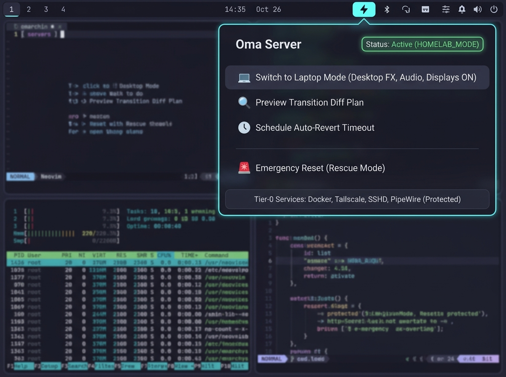
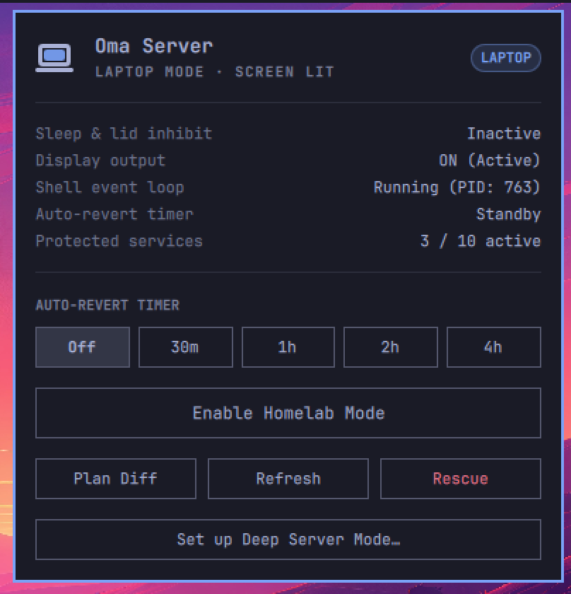
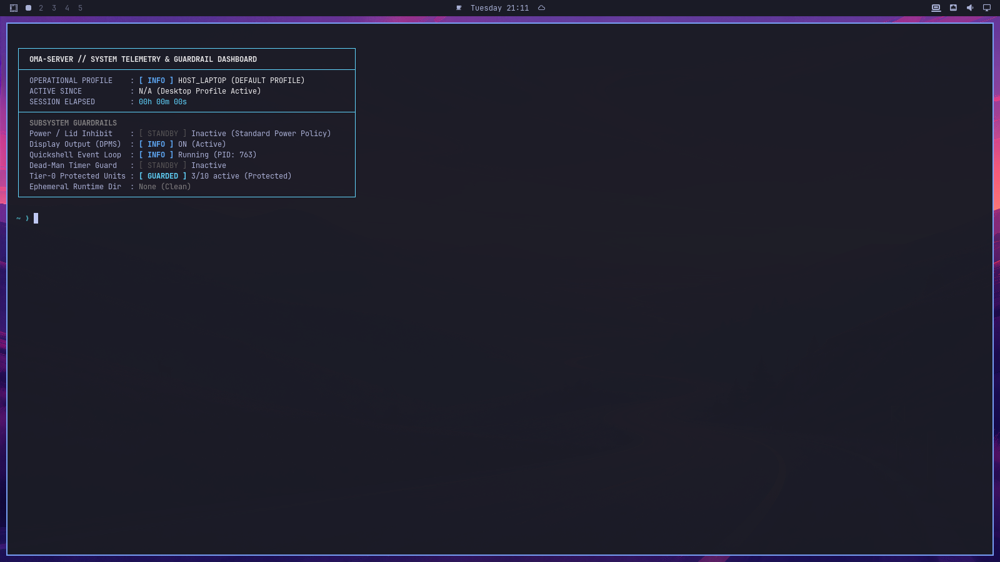
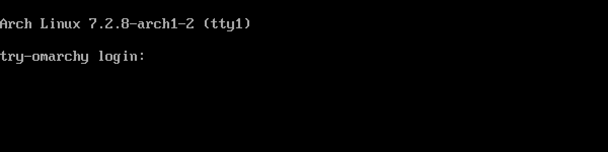

<p align="center">
  
</p>

<p align="center">
  <br>
  <strong>Enterprise Performance &amp; Homelab Mode Orchestrator for Omarchy (Arch + Hyprland + Quickshell)</strong>
</p>

<p align="center">
  <a href="#origin--motivation">Origin &amp; Motivation</a> |
  <a href="#core-capabilities--guardrails">Capabilities</a> |
  <a href="#architecture--state-machine">Architecture</a> |
  <a href="#installation">Installation</a> |
  <a href="#quickshell-telemetry-panel">Panel UX</a> |
  <a href="#cli-reference">CLI Usage</a> |
  <a href="#configuration">Configuration</a>
</p>

---

## Origin & Motivation

> *"Interactive desktop ergonomics when at the keyboard; zero-overhead headless compute when operating remotely over SSH or running autonomous AI workloads."*

Omarchy delivers a modern Linux desktop experience powered by Hyprland and Quickshell. For interactive daily-driver work, blur shaders, fluid animations, status panels, and audio subsystems provide exceptional ergonomics.

However, a modern workstation frequently operates in two distinct roles:
1. **Interactive Workstation (`HOST_LAPTOP`)**: Low input latency, rich visual polish, and standard desktop power management.
2. **Compute Node / Agent Runner (`HOMELAB_MODE`)**: When stepping away, connecting over SSH, or running heavy unattended workloads (autonomous AI agents, container clusters, compilation pipelines, or media transcoding), the desktop GUI becomes unnecessary overhead.

Leaving full Hyprland compositing, physical displays, and bar polling active during remote compute sessions:
* **Wastes 15-30W of power** keeping physical display panels illuminated.
* **Consumes GPU memory bandwidth** and shader time computing window animations and multi-pass blurs.
* **Triggers power management sleep loops** on lid-close or idle timeouts, interrupting active SSH sessions and background jobs.

**`oma-server` eliminates this trade-off.** It transitions the system into a hardened, low-overhead homelab profile on demand and restores the full interactive Omarchy desktop in under a second.

---

## Core Capabilities & Guardrails

* **Tier-0 Core Service Protection**: Strict systemd unit validation guarantees that `docker`, `containerd`, `podman`, `tailscaled`, `syncthing`, `caddy`, `nginx`, `sshd`, `pipewire`, and `wireplumber` remain untouched during transitions.
* **Transactional Rollback Engine**: Every state mutation step is tracked; if any pre-flight or runtime step fails, `oma-server` automatically rolls back completed steps and restores the host baseline.
* **Hyprland 0.56+ Lua & Legacy IPC Support**: Automatically detects and applies compositor overrides (`animations`, `decoration.blur`, `decoration.shadow`, `decoration.rounding`) and DPMS control via Hyprland's Lua runtime (`hl.config` / `hl.dsp.dpms`) with seamless fallback to legacy `keyword` / `dpms` IPC.
* **PID-Verified Process Signaling**: Inspects `/proc/<pid>/comm`, `/proc/<pid>/cmdline`, and UID ownership before issuing `SIGSTOP`, `SIGCONT`, or `SIGTERM`, preventing stale PID recycling hazards.
* **Non-Destructive Quickshell Pause**: Pre-notifies the bar widget so `◆` is rendered, then uses user-scoped `SIGSTOP` / `SIGCONT` to pause the shell event loop to 0 CPU ticks without tearing down memory maps, IPC sockets, or window state.
* **Panel Powerdown (DPMS Off)**: Powers down display outputs (`hl.dsp.dpms` / `dpms off`), saving 15-30W and reducing compositor passes to near zero.
* **Session-Detached Lid & Sleep Inhibit**: Spawns a `systemd --user` transient unit (`oma-server-inhibitor.service`) running `systemd-inhibit --no-ask-password` (`sleep:idle:handle-lid-switch`) so closing a laptop lid or logging out of SSH (`SIGHUP`) never halts running containers or background jobs.
* **Dead Man's Switch Timer**: Supports bounded `--timeout <duration>` (`5s` to `7d`, e.g. `oma-server enable --timeout 2h`) via a detached `systemd --user` timer worker (`oma-server-timer.service`) to automatically restore `HOST_LAPTOP` mode when unattended work finishes.
* **Zero Side-Effect Dry-Run**: `oma-server diff` and `oma-server enable --dry-run` evaluate live compositor and service state in a single batched IPC round-trip strictly in memory.

---

## Architecture & State Machine

```text
┌─────────────────────────────────────────────────────────────────────────┐
│                          SYSTEM OPERATIONAL STATE                       │
├────────────────────────────────────┬────────────────────────────────────┤
│         HOST_LAPTOP PROFILE        │        HOMELAB_MODE PROFILE        │
│    (Latency & Ergonomics First)    │  (Throughput & Availability First) │
├────────────────────────────────────┼────────────────────────────────────┤
│ - Hyprland shaders & animations ON │ - Compositor throttled (0 FX/blur) │
│ - Omarchy Quickshell active (◇)    │ - Omarchy Quickshell paused (◆)    │
│ - Standard sleep/lid-close policy  │ - systemd sleep/lid inhibit active │
│ - Physical display outputs ON      │ - Displays DPMS OFF (power saved)  │
│ - Tier-0 services running baseline │ - Tier-0 services guarded          │
└────────────────────────────────────┴────────────────────────────────────┘
                   │                                    ▲
                   ▼                                    │
         [ oma-server enable ]                [ oma-server disable ]
     (Atomic Snapshot & Pre-Flight)         (Transactional Restoration)
```

---

## Installation

Clone the repository and execute the installer:

```bash
git clone https://github.com/RohiRIK/oma-server.git
cd oma-server
./install.sh
```

The installer performs pre-flight artifact validation and:
1. Installs the CLI coordinator and modular libraries (`ui.sh`, `config.sh`, `snapshot.sh`, `transition.sh`) into `~/.config/omarchy/plugins/server-mode/`.
2. Symlinks `oma-server` and `omarchy-server-mode` into `~/.local/bin/`.
3. Installs the post-boot safety recovery hook into `~/.config/omarchy/hooks/post-boot.d/99-server-profile-check.sh`.
4. Installs and registers the Quickshell bar widget in `~/.config/omarchy/plugins/rohirik.oma-server/` (removing any deprecated `BarWidget.qml` from older versions).

If the installer runs outside the graphical session (for example over SSH, with no `WAYLAND_DISPLAY` / `HYPRLAND_INSTANCE_SIGNATURE`), it does **not** restart `omarchy-shell` (a restart from SSH would leave the desktop without a bar); it only asks the running shell to rescan plugins. If registering the widget fails, the installer says so and exits non-zero instead of reporting a complete install; if no shell is running it prints a warning. In both cases run the enable command below from a terminal inside the desktop session.

To enable and place the widget in the Omarchy status bar:
```bash
omarchy plugin enable rohirik.oma-server --section right
```
*(Once enabled, you can reposition it anytime with `omarchy bar move rohirik.oma-server --section left|center|right`.)*

### Uninstallation

If Deep Server Mode is active, `uninstall.sh` refuses to run; run `oma-server disable` first. If the deep-mode helper and sudoers rule are installed, it removes them first, which needs a terminal for the sudo password.

To cleanly restore `HOST_LAPTOP` mode, disable the bar widget, and remove the installed files and hooks:
```bash
./uninstall.sh
```

Your `~/.config/omarchy/plugins/server-mode/config.toml` is **kept by default**. From an interactive terminal the uninstaller asks whether to delete it (default: keep); non-interactive runs always keep it, so a later `./install.sh` picks your settings back up. To remove everything, including the config, without a prompt:
```bash
./uninstall.sh --purge
```

### Optional: Headless SSH Polkit Rule

When `oma-server enable` is run inside the active desktop or via `systemd --user` on an active graphical seat, `systemd-inhibit` is authorized automatically. On systems where `systemd-logind` requires explicit Polkit authorization for non-seat sessions, install the following optional rule at `/etc/polkit-1/rules.d/49-oma-server-inhibit.rules`:

```javascript
polkit.addRule(function(action, subject) {
    if ((action.id == "org.freedesktop.login1.inhibit-block-sleep" ||
         action.id == "org.freedesktop.login1.inhibit-block-idle" ||
         action.id == "org.freedesktop.login1.inhibit-handle-lid-switch") &&
        subject.isInGroup("wheel")) {
        return polkit.Result.YES;
    }
});
```

---

## Quickshell Telemetry Panel

`oma-server` ships with a native Quickshell bar widget (`Panel.qml`) featuring a zero-emoji, theme-adaptive telemetry interface:

<p align="center">
  
</p>

<p align="center">
  
  &nbsp;
  <br>
  <sub>Bar icon: lit in <code>HOST_LAPTOP</code> (left), dimmed and frozen in <code>HOMELAB_MODE</code> (right). Real captures.</sub>
</p>

* **Bar Indicator**: Vector laptop icon whose screen is illuminated (`lit: true`) in `HOST_LAPTOP` mode, dark/off (`lit: false`) in `HOMELAB_MODE` (reflecting DPMS display powerdown), and pulses smoothly during transitions.
* **Dashboard Popup**:

  <p align="center">
    <br>
    <sub>The popup in <code>HOST_LAPTOP</code>. Real capture.</sub>
  </p>

  * **Hero Header & Status Pill**: Displays mode icon, active profile title, live session elapsed time, and a semantic status pill (`DESKTOP`, `HOMELAB`, `SYNCING`, `DEGRADED`, `ERROR`).
  * **Animated Progress Track**: Displays a smooth progress bar and live elapsed timer during state transitions.
  * **Subsystem Telemetry**: Clean key-value rows reporting Sleep & Lid Inhibit, Display Output, Shell Event Loop, Auto-Revert Timer, and Protected Services.
  * **Auto-Revert Timer Presets**: One-click timeout presets (`Off`, `30m`, `1h`, `2h`, `4h`).
  * **Action Controls**: `Enable Homelab Mode`, `Plan Diff` terminal launcher, `Refresh`, `Rescue` emergency recovery, and `Set up Deep Server Mode…` / `Deep Server Mode…`.

> **The panel is a `HOST_LAPTOP` control.** `HOMELAB_MODE` pauses Quickshell with `SIGSTOP`, and the bar widget lives inside Quickshell, so while homelab is active the bar is frozen: the dimmed `◆` icon stays visible, but the popup cannot open and there is no clickable "Restore" button. Bring the desktop back with `oma-server disable` (SSH, a TTY, or a terminal keybind), the `--timeout` auto-revert, or `oma-server rescue`. The `Restore Desktop Mode` label only shows up during the brief transition before the freeze, or if the shell was not running when homelab started.

---

## CLI Reference

### 1. Inspect System Telemetry

<p align="center">
  
</p>

```bash
# Box-drawn TUI telemetry dashboard
oma-server status

# Machine-readable JSON telemetry payload
oma-server status --json
```

### 2. Preview Transition Plan (Dry-Run)
```bash
# In-memory transition diff table and Tier-0 service audit
oma-server diff

# Full dry-run simulation with optional timeout preview
oma-server enable --dry-run --timeout 2h
```

### 3. Transition to Homelab Mode
```bash
# Interactive mode (renders diff plan and prompts for confirmation)
oma-server enable

# Non-interactive transition with 3-hour Dead Man's Switch auto-revert timer
oma-server enable --yes --timeout 3h
```

### 4. Restore Host / Laptop Desktop
```bash
oma-server disable
```
Resumes Quickshell (`SIGCONT`), powers on displays (`DPMS on`), restores captured Hyprland options, and releases inhibitor/timer units.

### 5. Emergency Rescue
```bash
oma-server rescue
```
Unconditionally unfreezes any stopped Quickshell instances, powers on all display outputs, terminates active inhibitor/timer units, reloads Hyprland configuration, and purges ephemeral lockfiles.

---

## Deep Server Mode (opt-in)

<p align="center">
  <br>
  <sub>What the screen shows in <code>DEEP_SERVER</code>: a plain text console on tty1 with a real <code>login:</code> prompt, like Ubuntu Server.</sub>
</p>

`HOMELAB_MODE` keeps your apps open and only pauses the desktop. **`DEEP_SERVER`** makes the machine behave like a headless Ubuntu server: no compositor, no bar, no GUI apps and no greeter. SSH, networking, docker/containers, agents and `systemd --user` services keep running. One command brings the full Omarchy desktop back through SDDM autologin.

It is **off by default**. A normal `./install.sh` installs nothing root-owned and never turns it on.

### One-time setup (needs a terminal and your sudo password)
```bash
oma-server deep-setup            # shows the files and the sudoers line, asks y/N
oma-server deep-setup --remove   # removes the helper and the sudoers rule again
```
`deep-setup` installs, following the same pattern as Omarchy's own `etc/sudoers.d` rules:
- `/usr/local/lib/oma-server/deep-helper`: owned by root:root with mode 0755, in a root-owned directory. Its sha256 is pinned in `lib/deep.sh`, and setup refuses a modified copy. It only accepts a fixed set of verbs (`check`, `dm-stop`, `dm-start`, `dm-restart`, `inhibit-start`, `inhibit-stop`, `revert-arm <seconds>`, `revert-disarm`, `exit`). It takes no paths, no unit names and no shell input, and it pins `PATH`.
- `/etc/sudoers.d/oma-server-deep`: mode 0440. It is checked with `visudo -cf` and then moved into place atomically. It contains a `%wheel NOPASSWD` grant that spells out each of those exact commands. Requires sudo 1.9.10 or newer built with sudoers regex support. Arch/Omarchy has it; on builds without it (Ubuntu's, for example) `visudo -cf` fails and setup installs nothing.

> **Upgrading from an earlier 1.2.0 build:** the helper changed (it now brings up the tty1 console), so its pinned hash changed. The CLI compares the installed helper with that pinned hash: until you re-run `oma-server deep-setup`, `enable --deep` refuses ("helper is outdated"), `status` shows `DEGRADED` / "deep helper outdated", and `diff --deep` shows `OUTDATED helper`. Leaving deep mode (`disable`, `rescue`, the timers) still works with the old helper, so you are never stuck. Re-running setup replaces the helper; the sudoers rule stays the same.

Because of that grant, any process running as a wheel user can stop and start the desktop without a password. That is a local denial of service, not a privilege escalation. The setup prompt says so before installing.

### Use
```bash
oma-server diff --deep                          # plan: windows that would close, units that stop
oma-server enable --deep                        # refuses while any window is open
oma-server enable --deep --close-apps           # lists the windows, then you must type: yes
oma-server enable --deep --timeout 2h           # optional auto-revert (user timer + root backup timer)
oma-server disable                              # from SSH or a TTY: brings the desktop back
```
- **Open windows:** the default is to refuse. To close them you need `--close-apps`, an interactive terminal, and the literal word `yes`. `-y` is rejected, and there is no config key that closes apps.
- **Timer:** created only when you pass `--timeout`. Deep mode ignores `[profile] default_timeout`.
- **Enter:** `uwsm stop`, then the display manager is stopped. The helper then starts `getty@tty1.service` and switches to tty1 (`chvt 1`), so the screen shows a real `login:` prompt instead of a blank VT. Linger is enabled while in deep mode so user services survive, and a root sleep/lid inhibitor is held.
- **Exit:** the helper stops `getty@tty1` (so the display manager gets tty1 back), the display manager is started again, and SDDM autologin brings Hyprland back. Then the inhibitor and timers are released and linger is restored.
- **Not changed:** the default target (`graphical.target`), so a reboot always returns to the desktop.
- **Terminal agents:** agents started from a GUI terminal die with the session. Run them as `systemd-run --user` units, or in tmux started that way.

### The tty1 console and the optional deep shell

At the machine, log in at the tty1 `login:` prompt with your normal user and password. By default you get a plain shell; run `oma-server disable` to bring the desktop back. On tty1 (or inside the deep shell), `disable` and `rescue` hand the exit sequence to a detached `systemd-run --user` unit (`oma-server-deep-exit`), because bringing the display manager back stops `getty@tty1` and hangs up that console; the helper also ignores `SIGHUP`.

You can opt in to a TUI that starts after that login. It is configured as `[deep] shell` (default `"none"`) and set with:

```bash
oma-server deep-shell                 # show the current choice and which programs are installed
oma-server deep-shell none            # default: plain console + login: prompt, no profile edits
oma-server deep-shell tmux            # tmux new-session -A -s deep (SSH can `tmux attach -t deep`)
oma-server deep-shell btop            # system monitor
oma-server deep-shell tuios           # advanced: terminal window manager
oma-server deep-shell custom --command "htop -d 20"   # runs [deep] shell_command via bash -c
```

`zellij` also works (`zellij attach --create deep`).

- **Where it runs:** only for an interactive login on **tty1** while the state is `DEEP_SERVER`. SSH logins, other TTYs, a tty1 login outside deep mode, and nested sessions are never affected.
- **How:** any choice other than `none` adds a small marked block to `~/.bash_profile` (or `~/.zprofile` for zsh) that calls `libexec/oma-server-deep-shell login`. `deep-shell none` and `uninstall.sh` remove that block. fish users add the line by hand: `if test (tty) = /dev/tty1; ~/.config/omarchy/plugins/server-mode/libexec/oma-server-deep-shell login; end`.
- **Escape hatch:** after login it waits 3 s; press any key to skip the TUI for that login. Set `OMA_DEEP_SHELL_WAIT` (seconds, e.g. `export OMA_DEEP_SHELL_WAIT=10` in your profile before the block) to change the wait; a non-numeric value falls back to 3 s.
- **Fallback:** the program runs as a child of your login shell, never `exec`. If it is missing, crashes or you quit it, you land in the plain shell; after a crash or error the screen is not cleared, so its message stays visible. For `custom`, the command's first program is checked too: `deep-shell custom` warns if it is not installed, and at login it is skipped. An unknown value also falls back to the plain shell.
- **tuios:** tuios is modal, like vim: it starts in window-management mode, so press `i` to start typing in a terminal (Esc goes back). Quitting tuios (Ctrl-b q, "Kill and quit") leaves its background `tuios daemon` running, and the next start restores the previous session. That is upstream behaviour; stop it with `pkill -f 'tuios daemon'` if you want a clean start. The tmux and zellij `deep` sessions likewise stay alive after the desktop returns, so you can reattach.
- Runs as your user only: no root, and no sudoers change.

### Getting back without a bar
1. Over SSH: `oma-server disable`.
2. At the machine: log in at the tty1 `login:` prompt (or Ctrl+Alt+F2), then `oma-server disable`.
3. Reboot or long-press power. Autologin brings the desktop back and the post-boot hook clears the deep-mode state.
4. Panic command: `sudo systemctl start display-manager`.

> **Lockout risk without `--timeout`:** if SSH becomes unreachable (Wi-Fi drops, the IP changes, sshd dies) and nobody is at the machine, the desktop stays down. With the lid closed, the inhibitor keeps the machine awake: heat and battery drain if it goes into a bag. `[deep] require_ssh = true` (the default) refuses to enter unless `sshd.service` is active.

> **Slow start jobs:** `uwsm stop` is refused (`TransactionIsDestructive`) while a user start job is still queued, e.g. a slow autostart unit right after login. Deep mode then waits for the user job queue to drain, up to `[deep] job_wait_seconds` (default 180 s, max 600, chosen to cover a ~3-minute startup job), and retries once. If it is still refused, it rolls back and names the queued unit.

## Configuration

Configured via `~/.config/omarchy/plugins/server-mode/config.toml`:

```toml
[profile]
default_mode = "host"
dpms_off_on_enable = true
auto_wake_on_input = true
quickshell_strategy = "sigstop"    # only "sigstop" is implemented; other values warn and fall back
default_timeout = "0"              # "0" = manual restore, or e.g. "45m", "2h"

[inhibit]
what = "sleep:idle:handle-lid-switch"
why = "Omarchy Homelab Workload Active"

[whitelist]
# Tier-0 protected services: Guaranteed untouched during mode switches
services = [
  "docker.service",
  "containerd.service",
  "podman.service",
  "tailscaled.service",
  "syncthing.service",
  "caddy.service",
  "nginx.service",
  "sshd.service",
  "pipewire.service",
  "wireplumber.service"
]

[deep]
# Deep Server Mode (opt-in): stops Hyprland and the display manager, keeps SSH/docker/user services.
# `oma-server deep-setup` flips `allowed` to true; `enable --deep` refuses while it is false.
# There is deliberately no key to close apps or to force a timeout.
allowed = false
stop_display_manager = true
exit_wait_seconds = 45             # how long `disable` waits for Hyprland to come back
job_wait_seconds = 180             # if uwsm refuses to stop because a user start job is queued, wait this long (0-600) for the queue to drain, then retry once
require_ssh = true                 # refuse unless sshd.service is active
# Console on tty1 while in Deep Server Mode. "none" (default) = plain text console with a
# `login:` prompt, like Ubuntu Server. Opt in with `oma-server deep-shell <name>`:
# tmux | btop | tuios (advanced) | custom (runs shell_command); zellij also works.
# Only an interactive login on tty1 is affected (never SSH); any key within 3 s skips it,
# and quitting, a crash or a missing program leaves you in the plain shell.
shell = "none"
shell_command = ""
```

---

## Dependencies

* `bash` (5.0+)
* `hyprland` / `hyprctl`
* `jq`
* `util-linux` (`flock`, `setsid`)
* `coreutils` (`timeout`, `date`, `tr`, `realpath`)
* `systemd` (`systemd-inhibit`, `systemd-run`, `systemctl`)

---

## License

MIT (c) RohiRIK
